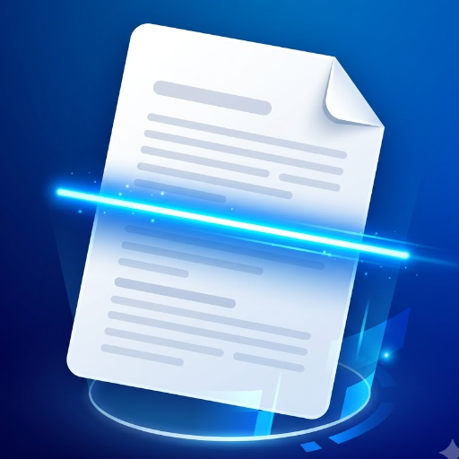
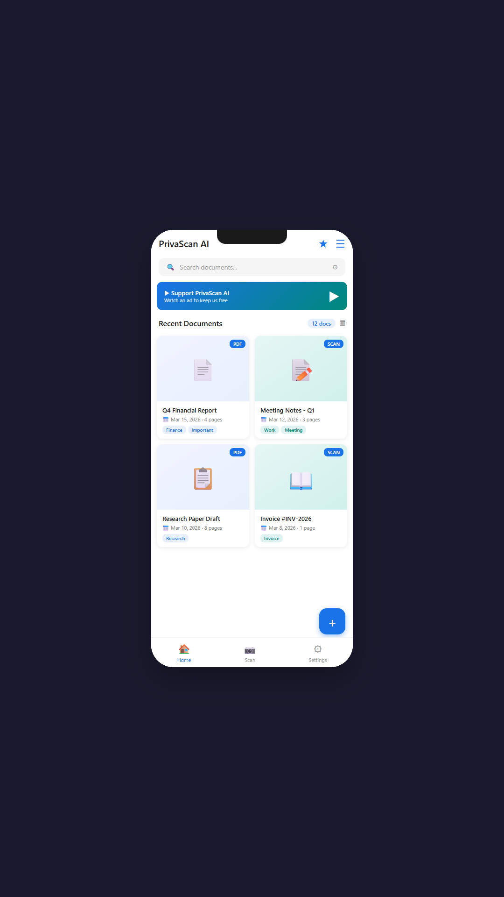
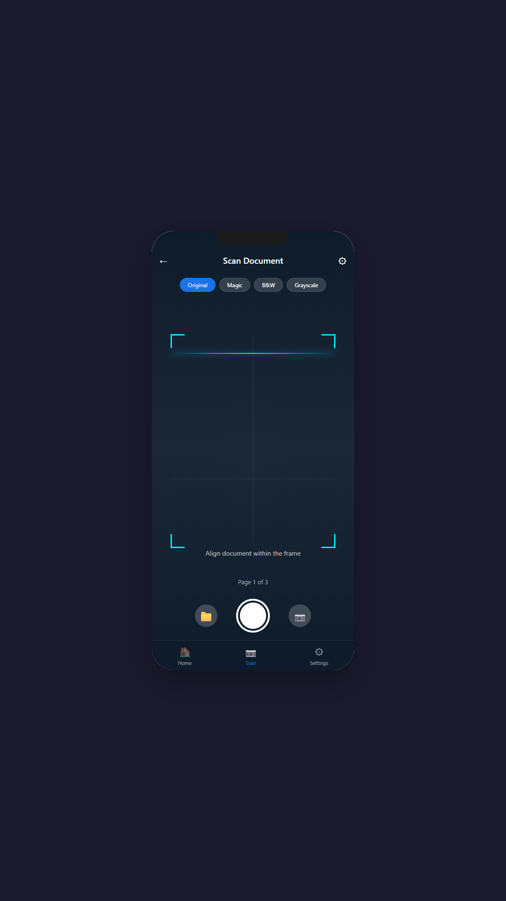
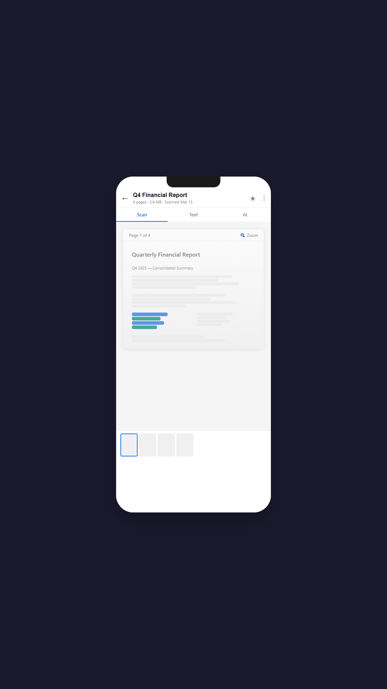
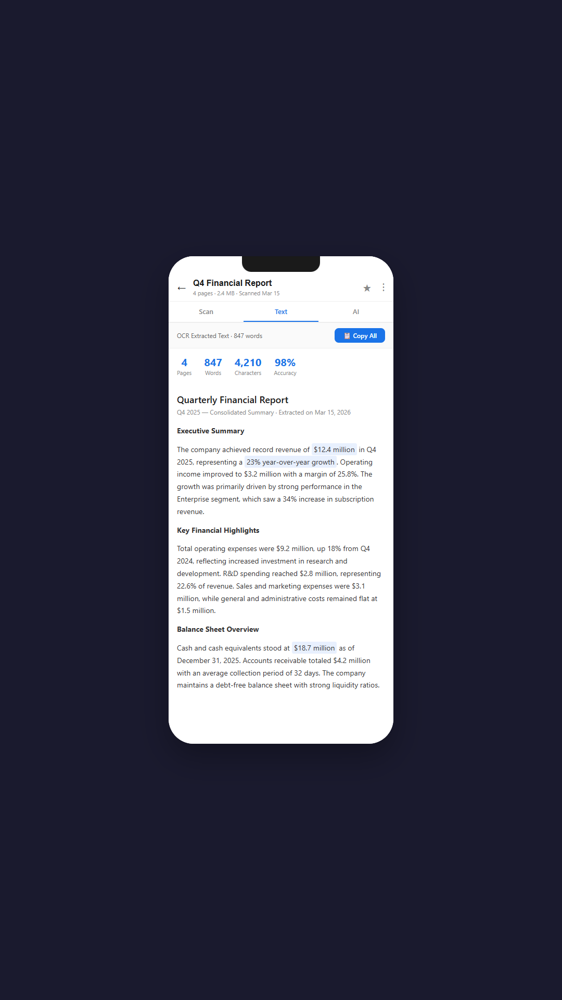
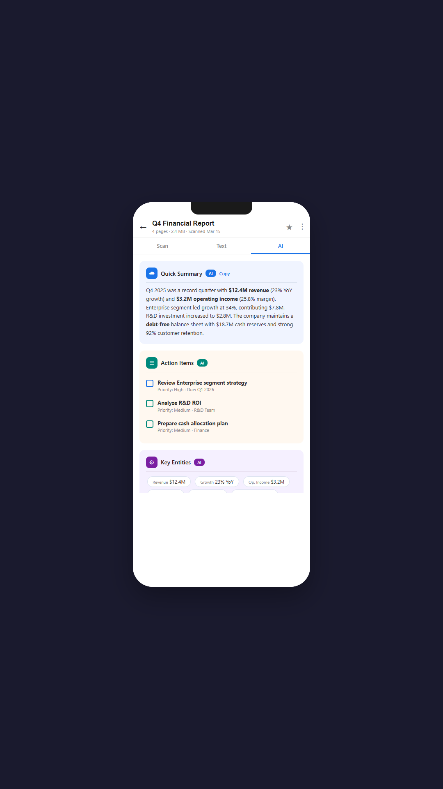

<div align="center">

  

  # PrivaScan AI
  ### Privacy-First On-Device Document Scanner, OCR & AI Summarizer

  <p align="center">
    <b>Scan, digitize, extract, translate, and summarize documents with 100% on-device AI. No cloud uploads. Zero data tracking. Complete privacy.</b>
  </p>

  [](https://flutter.dev)
  [](https://dart.dev)
  [](https://flutter.dev)
  [](LICENSE)
  [](https://play.google.com/store/apps/details?id=com.privascan.ai)
  [](https://github.com)

  <br />

  <a href="https://play.google.com/store/apps/details?id=com.privascan.ai">
    
  </a>

  <p>
    🚀 <b>Live Demo Available:</b> <a href="https://play.google.com/store/apps/details?id=com.privascan.ai"><b>Download PrivaScan AI on Google Play Store</b></a>
  </p>

</div>

---

## 📱 App Preview & Screenshots

<div align="center">
  <table>
    <tr>
      <td align="center"><b>Dashboard & Vault</b></td>
      <td align="center"><b>Smart Scanner</b></td>
      <td align="center"><b>Document Viewer</b></td>
      <td align="center"><b>100% Offline OCR</b></td>
      <td align="center"><b>AI Summarizer</b></td>
    </tr>
    <tr>
      <td></td>
      <td></td>
      <td></td>
      <td></td>
      <td></td>
    </tr>
  </table>
</div>

---

## 🌟 Key Features

### 📄 Smart Camera & Document Enhancement
- **Auto Edge Detection & Crop:** Automatic contour detection with manual corner adjustment.
- **Color Filters:** Instant enhancement modes including **Magic Color**, **B&W (High Contrast)**, and **Grayscale**.
- **Multi-Page Batch Scanning:** Quickly scan multi-page agreements, books, and receipts into a single document.

### ⚡ 100% On-Device Optical Character Recognition (OCR)
- Ultra-fast text extraction powered by **Google ML Kit Vision**.
- **Zero latency & works fully offline:** No internet connection required.
- Copy, search, edit, or export extracted text directly to TXT or PDF.

### 🤖 Local AI Document Intelligence
- **Instant Summarization:** Get quick bullet-point summaries of contracts, invoices, and study notes.
- **Action Items & Entity Extraction:** Automatically extract dates, amounts, email addresses, and key to-dos.
- **Smart Document Classification:** Auto-categorizes scans into *Invoices*, *Identity Cards*, *Medical*, *Receipts*, and *Contracts*.

### 🌐 Offline Language Translation
- Translate scanned document text into **50+ languages** locally using on-device neural translation models.
- Downloadable language packs that preserve complete data confidentiality.

### 🎧 Audio Reader (Text-to-Speech)
- High-quality native Text-to-Speech (TTS) to listen to scanned documents, books, and study materials on the go.

### 🔏 Digital Signatures & Security
- **Draw or Import Signatures:** Place and resize custom signatures directly on documents.
- **Custom Watermarks & Stamps:** Protect confidential documents with customizable status stamps (*Approved*, *Confidential*, *Urgent*).
- **Password-Protected PDFs:** Export standard AES-encrypted PDFs requiring a password to open.

### 🔍 QR & Barcode Scanner
- Multi-format code detection with instant clipboard copy, URL launching, and auto-detection.

---

## 🔒 Privacy-First Architecture

Unlike traditional document scanners that upload your sensitive identification and financial records to cloud servers:

```
┌─────────────────────────────────────────────────────────────┐
│                       PrivaScan AI                          │
│                                                             │
│  [ Camera / Gallery ]  ──►  [ Local ML Kit Engine ]         │
│                                     │                       │
│                                     ▼                       │
│  [ Encrypted PDF / Text ] ◄──  [ Encrypted Hive Database ]   │
│                                                             │
│                   ❌ NO Cloud Database                      │
│                   ❌ NO Analytics Tracker                   │
│                   ❌ NO Third-Party Data Sharing            │
└─────────────────────────────────────────────────────────────┘
```

- **100% Local Execution:** OCR, image processing, translation, and summaries run directly on your smartphone processor.
- **No Sign-In Required:** Use the app immediately without giving your email, phone number, or identity.
- **Local Storage:** Documents and tags are stored strictly in local Hive databases on device storage.

---

## 🛠️ Tech Stack & Architecture

- **Framework:** [Flutter](https://flutter.dev) (v3.11+)
- **Language:** [Dart](https://dart.dev)
- **Architecture Pattern:** Clean Architecture + Feature-Driven Structure
- **State Management:** [flutter_bloc](https://pub.dev/packages/flutter_bloc) (`^9.1.1`)
- **Local Database:** [Hive](https://pub.dev/packages/hive) & [hive_flutter](https://pub.dev/packages/hive_flutter)
- **Machine Learning & Vision:**
  - `google_mlkit_text_recognition`
  - `google_mlkit_translation`
  - `google_mlkit_language_id`
  - `google_mlkit_barcode_scanning`
- **PDF Generation & Printing:** `pdf` & `printing`
- **Monetization & Billing:** `google_mobile_ads` & `in_app_purchase`

---

## 📁 Project Structure

```text
lib/
├── core/
│   ├── constants/       # App constants, limits, and database keys
│   └── theme/           # AppTheme, dark/light palettes, styles
├── data/
│   ├── models/          # Hive adapters & data models (Document, Tag)
│   ├── repositories/    # Repository implementations
│   └── services/        # On-device services (OCR, AI, Backup, PDF, TTS)
├── domain/
│   ├── entities/        # Core business entities
│   └── repositories/    # Repository interfaces
└── presentation/
    ├── blocs/           # DocumentBloc, AiBloc, ScannerBloc, ThemeCubit
    ├── screens/         # Dashboard, Scanner, DocumentViewer, Translation, Settings
    └── widgets/         # Reusable UI components & dialogs
```

---

## 🚀 Getting Started & Local Setup

### Prerequisites
- [Flutter SDK](https://docs.flutter.dev/get-started/install) (3.11 or higher)
- [Android Studio](https://developer.android.com/studio) / [VS Code](https://code.visualstudio.com/)
- Android SDK (API 26+)

### 1. Clone the Repository
```bash
git clone https://github.com/OPSHARP/privascan_ai.git
cd privascan_ai
```

### 2. Install Dependencies
```bash
flutter pub get
```

### 3. Setup Android Signing (Optional for Debug)
Debug builds will work out of the box with default debug keys. For custom release builds:
1. Copy the sample signing template:
   ```bash
   cp android/key.properties.example android/key.properties
   ```
2. Fill in your keystore credentials in `android/key.properties`.

### 4. Run the Application
Connect an Android device or launch an emulator:
```bash
flutter run
```

---

## 🤝 Contributing

Contributions are welcome! If you'd like to improve PrivaScan AI:
1. Fork the Project
2. Create your Feature Branch (`git checkout -b feature/AmazingFeature`)
3. Commit your Changes (`git commit -m 'Add some AmazingFeature'`)
4. Push to the Branch (`git push origin feature/AmazingFeature`)
5. Open a Pull Request

---

## 📄 License

Distributed under the **MIT License**. See [`LICENSE`](LICENSE) for more information.

---

<div align="center">
  Made with ❤️ for Privacy and Open Source Software.
  <br />
  <a href="https://play.google.com/store/apps/details?id=com.privascan.ai"><b>Download on Google Play</b></a>
</div>
